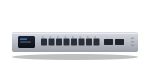
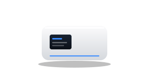

# UniFi Box Card

[](https://my.home-assistant.io/redirect/marketplace_repository/?owner=hoentaex&repository=ha-internet-box-card-unifi&category=plugin)
[](https://github.com/hoentaex/ha-internet-box-card-unifi/actions/workflows/validate.yml)
[](https://github.com/hoentaex/ha-internet-box-card-unifi/releases/latest)

A Home Assistant dashboard card for the gateway of a **UniFi Network**: Dream Machine, Cloud Gateway, Dream Router, Next-Gen / Security Gateway, Express. It shows the connection status, WAN throughput and latency, the last speed test, CPU, RAM and temperature, and the connected devices, with a restart button.

It is a fork of [ha-internet-box-card](https://github.com/juju35/ha-internet-box-card) by juju35, which covers the internet boxes of many operators (Freebox, Livebox, FRITZ!Box, Vodafone Station, Starlink…); see the original project for those. The cards of this fork are registered as `custom:unifi-box-card` and `custom:unifi-box-mini-card`, so they can be installed next to the original card.

> [!WARNING]
> This is a hobby project, maintained in spare time for personal use. It comes without any warranty or support: **use it at your own risk**.

## What it shows

| Shown | From |
|---|---|
| Status pill (online / offline) | the gateway's device state sensor (`connected`) |
| Download / upload, with their 24 h curve | the gateway's WAN port bandwidth sensors, see [Download / upload](#download--upload) |
| WAN latency, with its 24 h curve | the gateway's WAN latency sensors (Google, Cloudflare, Microsoft; disabled by default), one tile each |
| Uptime | the gateway's uptime sensor |
| Speed test: download and upload with their 24 h curve, ping, time of the test | the [Speedtest.net](https://www.home-assistant.io/integrations/speedtestdotnet/) integration, when set up |
| CPU and RAM use | the gateway's CPU and memory utilization sensors, rings next to the temperatures |
| Temperatures | the gateway's temperature sensors (CPU, local, PHY…) |
| Connected devices | the integration's client trackers |
| Restart button | the gateway's restart button (not the PoE power cycle buttons) |

Only a device whose model is a gateway (UDM…, UDR…, UCG…, UXG…, USG / UGW…, EFG, UX), or that has the WAN latency sensors only a gateway gets, is taken as the box: the switches and access points of the integration are left out.

The gateway picture follows its form factor; set the `model` option to pick another one.

| Rack unit | Desktop box | Cylinder |
|:---:|:---:|:---:|
|  |  |  |
| Dream Machine Pro / SE / Pro Max, Next-Gen Gateway | Cloud Gateway Ultra / Max / Fiber, Dream Wall, Express, Security Gateway | Dream Machine, Dream Router |

The pictures are drawn for this card; they are not product photos.

## Prerequisites

- Home Assistant with the [UniFi Network](https://www.home-assistant.io/integrations/unifi/) integration set up
- Optional: the [Speedtest.net](https://www.home-assistant.io/integrations/speedtestdotnet/) integration for the speed test section
- The connected devices count uses the `device_tracker` entities of the integration; the WAN latency sensors are disabled by default: enable the ones you want to see

### Download / upload

The UniFi Network integration has no WAN throughput sensor of its own; the port bandwidth sensors of the gateway give it:

1. **Settings → Devices & services → UniFi Network → Configure**, and turn on the **bandwidth sensors** option (it also creates bandwidth sensors for the network clients).
2. Open the gateway device and enable the **RX** and **TX** sensors of its WAN port (they are disabled by default), for example `Port 9` on a Dream Machine Pro, or `SFP+ 1` when the line is on that port.
3. If you enable the bandwidth sensors of other ports too, name the WAN port "WAN" in the UniFi controller: the card prefers the port whose name contains "WAN", else it takes the first port with enabled sensors.

RX is the download, TX the upload.

The rates are shown in bytes (MB/s) by default; set `rate_unit: bits` (or **Rate unit: bits** in the card editor) to read them in Mbit/s, as the speed test and the internet providers give them (39.4 MB/s = 315 Mbit/s).

## Installation

### Via the Marketplace (recommended)

Click the button to open the repository in the Marketplace of your Home Assistant:

[](https://my.home-assistant.io/redirect/marketplace_repository/?owner=hoentaex&repository=ha-internet-box-card-unifi&category=plugin)

Then click **Install**, and reload your browser when the Marketplace asks you to.

Or by hand:

1. Open **Settings → Marketplace → Add from link** (top right; this needs a GitHub account connected)
2. Add `https://github.com/hoentaex/ha-internet-box-card-unifi`, type **Dashboard**
3. Open **UniFi Box Card** and click **Install**
4. Clear your browser cache and refresh

### Manual

1. Download `internet-box-card.js` and the `internet-box-card.i18n.*.js` translation files from the [latest release](https://github.com/hoentaex/ha-internet-box-card-unifi/releases/latest)
2. Copy them all to `/config/www/` (without the translation files, the cards show in English)
3. Go to **Settings → Dashboards → ⋮ → Resources** → Add resource: URL `/local/internet-box-card.js`, type **JavaScript Module**
4. Clear your browser cache and refresh

## Configuration

### Visual editor

Edit a dashboard, click **Add card** and search for **UniFi Box Card** or **UniFi Box Mini Card**. The gateway is preselected; set an optional title, choose the sections to display and their order, the thresholds, the rate unit and the language. Options left at their default are kept out of the generated YAML.

### Minimal

```yaml
type: custom:unifi-box-card
```

```yaml
type: custom:unifi-box-mini-card
```

### Full options

```yaml
type: custom:unifi-box-card
box: 0123456789abcdef0123456789abcdef
title: Gateway
model: unifi_cloud_gateway_ultra
admin_url: https://unifi.ui.com
show_image: true
show_logo: true
show_network: true
show_history: true
show_speedtest: true
show_system: true
show_storage: true
show_services: true
section_order: [system, network, speedtest, services, storage]
cpu_warning: 80
cpu_critical: 95
ram_warning: 85
ram_critical: 95
temp_warning: 75
temp_critical: 90
rate_unit: bits
language: de
```

```yaml
type: custom:unifi-box-mini-card
box: 0123456789abcdef0123456789abcdef
show_network: true
show_history: true
show_system: true
zoom: true
rate_unit: bits
```

### Options reference

| Option | Card | Default | Description |
|---|---|---|---|
| `box` | both | First gateway found | Gateway to display, by its device id (only needed with several, pick it in the visual editor) |
| `title` | both | Gateway model | Card title |
| `model` | both | Detected | Gateway model, for its picture and the default title |
| `admin_url` | both | `https://unifi.ui.com` | Address opened when clicking the gateway picture |
| `show_image` | both | `true` | Show the gateway picture |
| `show_logo` | both | `true` | Show the header icon, coloured with the link state |
| `show_network` | both | `true` | Download / upload, WAN latency and uptime |
| `show_history` | both | `true` | 24 h curves under the rate, latency and speed test tiles, from the recorder's 5-minute statistics |
| `show_speedtest` | full | `true` | The last Speedtest.net test, a section of its own, when that integration is set up |
| `show_system` | both | `true` | CPU, RAM and temperatures (hottest temperature on the mini card) |
| `show_storage` | full | `true` | Disk partitions, when the gateway exposes some |
| `show_services` | full | `true` | Connected devices |
| `section_order` | full | `[network, speedtest, system, storage, services]` | Order of the sections, see below |
| `cpu_warning` / `cpu_critical` | both | `80` / `95` | CPU use (in %) from which the ring turns orange / red |
| `ram_warning` / `ram_critical` | both | `85` / `95` | RAM use (in %) from which the ring turns orange / red |
| `temp_warning` / `temp_critical` | both | `75` / `90` | Temperature (in °C, whatever the sensor's unit) from which it turns orange / red |
| `disk_warning` / `disk_critical` | both | `80` / `90` | Disk usage (in %) from which a partition turns orange / red |
| `zoom` | mini | `true` | Detail button at the top right: shows the full card in place of the mini card, and back |
| `rate_unit` | both | `bytes` | Rate unit: `bytes` (kB/s, MB/s) or `bits` (kb/s, Mb/s) |
| `language` | both | Auto | Force the language (`en`, `de`, `fr`, `es`, `it`, `nl`… 22 in all); by default the one of Home Assistant |

### Order of the sections

The sections of the full card (network, speed test, system, storage, services) can be put in any order: in the card editor drag them in **Order of the sections**, or in YAML with `section_order`. Sections left out of the list follow in their default order; the `show_*` options still show or hide each section.

## Development

```bash
npm install
npm run build   # bundles src/internet-box-card.js into dist/ (card and translation files)
npm test        # unit and browser tests (the browser tests need: npx playwright install chromium)
npm run check   # builds and checks the card (run in CI)
```

`dist/` is not committed: the release workflow builds it and attaches it to the release, which is where the Marketplace installs it from.

To release, bump `version` in `package.json` (and `package-lock.json`), add a `## <version>` section at the top of [CHANGELOG.md](CHANGELOG.md) and push to `main`: the **Release** workflow tests the card, creates the tag and the GitHub release with that section as notes.

## License

[MIT](LICENSE), like the original project by juju35.

UniFi and Ubiquiti are trademarks of Ubiquiti Inc. This project is not affiliated with or endorsed by Ubiquiti, nor by the authors of the original card.
